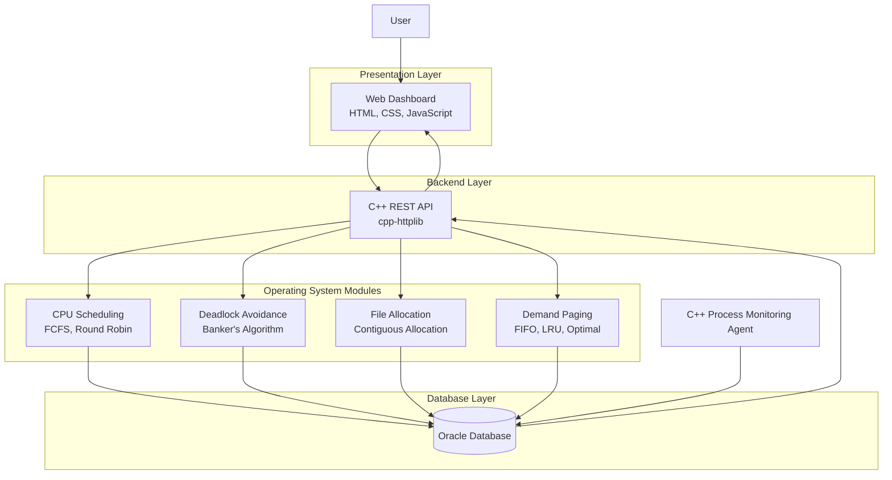
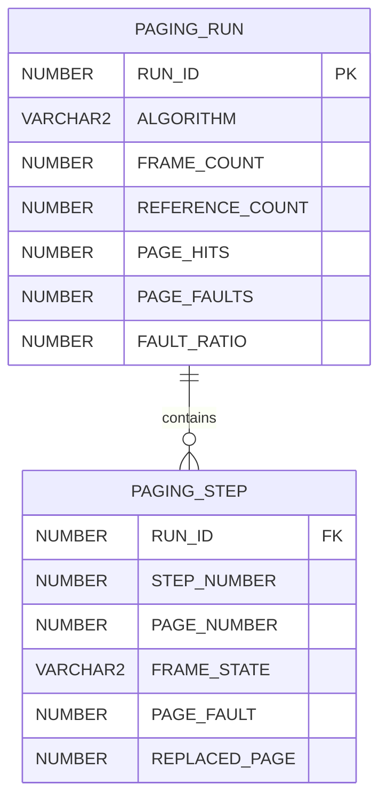

# ⚙️ Kernel Query Execution & Paging System

<p align="center">
  
</p>

<p align="center">
  <strong>A unified simulation platform connecting Operating System algorithms with database-backed execution.</strong>
</p>

<p align="center">
  
  
  
  
</p>

<p align="center">
  <a href="#overview">Overview</a> •
  <a href="#modules">Modules</a> •
  <a href="#system-architecture">Architecture</a> •
  <a href="#database-design">Database</a> •
  <a href="#api-reference">API</a> •
  <a href="#setup-and-installation">Setup</a> •
  <a href="#testing">Testing</a>
</p>

---

<a id="overview"></a>
## ✨ 1. Overview

**Kernel Query Execution & Paging System** is an integrated Operating Systems and Database Management Systems project designed to simulate, execute, visualize, and persist fundamental Operating System operations.

The platform combines modular C++ implementations of OS algorithms with Oracle Database connectivity and an interactive web dashboard.

Users can:

- Execute Operating System algorithm simulations.
- Visualize intermediate execution states.
- Analyze resource allocation and memory management.
- Compare algorithm performance.
- Persist execution records in Oracle Database.
- Monitor process information and resource utilization.

### Project Objectives

- Implement fundamental OS algorithms using modular C++.
- Integrate OS simulations with Oracle Database.
- Design REST-based communication between frontend and backend.
- Visualize algorithm execution through an interactive dashboard.
- Persist simulation results and execution history.
- Demonstrate database connectivity using Oracle OCCI.
- Apply modular programming and separation of concerns.

---

<a id="modules"></a>
## 🧠 2. Core Modules

<details>
<summary><strong>⚡ CPU Scheduling</strong></summary>

Implements CPU scheduling algorithms to simulate process execution and CPU allocation.

**Algorithms:**
- First Come First Serve (FCFS)
- Round Robin (RR)

**Functionalities:**
- Process configuration.
- Arrival and burst time handling.
- Scheduling execution.
- Process execution ordering.
- Scheduling performance analysis.

</details>

<details>
<summary><strong>🔒 Deadlock Avoidance</strong></summary>

Implements the Banker's Algorithm to determine whether resource allocation can leave the system in a safe state.

**Functionalities:**
- Allocation matrix.
- Maximum resource requirement matrix.
- Available resource vector.
- Need matrix calculation.
- Safe-state verification.
- Safe sequence generation.

</details>

<details>
<summary><strong>📁 Contiguous File Allocation</strong></summary>

Simulates contiguous file allocation in which each file occupies consecutive disk blocks.

**Functionalities:**
- File allocation requests.
- Disk block allocation.
- Contiguous storage representation.
- Allocation result visualization.
- Storage utilization analysis.

</details>

<details>
<summary><strong>🧮 Demand Paging and Page Replacement</strong></summary>

Implements demand paging and compares three classical page replacement algorithms.

**Algorithms:**

| Algorithm | Replacement Strategy |
|---|---|
| FIFO | Replaces the earliest loaded page |
| LRU | Replaces the least recently used page |
| Optimal | Replaces the page needed farthest in the future |

**Functionalities:**
- Configurable memory frame count.
- Custom page reference strings.
- Step-by-step frame visualization.
- Page hit and page fault calculation.
- Page fault ratio calculation.
- Comparison of all three algorithms.
- Oracle-backed simulation persistence.

</details>

<details>
<summary><strong>📊 Process Monitoring</strong></summary>

A separate C++ monitoring agent collects process-related information and resource utilization measurements.

**Functionalities:**
- Process identification.
- Process name and computer identification.
- CPU usage monitoring.
- Memory usage monitoring.
- Periodic resource measurement storage.
- Dashboard-based process inspection.

</details>

---

<a id="system-architecture"></a>
## 🏗️ 3. System Architecture

The application follows a modular and layered architecture. The frontend communicates with the C++ backend, which coordinates OS algorithms and Oracle Database operations.

### Architecture Diagram



### Architecture Components

| Layer | Responsibility | Technology |
|---|---|---|
| Presentation | Dashboard and user interaction | HTML, CSS, JavaScript |
| Backend | API routing and execution coordination | C++ |
| OS Engine | Scheduling, deadlock, allocation and paging | C++ |
| Database | Persistent storage and retrieval | Oracle Database |
| Monitoring | Process and resource collection | C++ |

### Execution Flow

1. The user submits an algorithm configuration through the dashboard.
2. The frontend sends an HTTP request to the C++ backend.
3. The backend validates the request parameters.
4. The corresponding OS algorithm executes.
5. The backend persists supported simulation results in Oracle Database.
6. The execution result is returned to the frontend.
7. The dashboard displays the results and execution details.

---

<a id="database-design"></a>
## 🗄️ 4. Database Design

Oracle Database acts as the persistent storage layer of the application.

The C++ backend communicates with Oracle using the **Oracle C++ Call Interface (OCCI)**.

### Database Responsibilities

- Persist simulation execution summaries.
- Store individual algorithm execution steps.
- Maintain process information.
- Store resource utilization measurements.
- Support structured retrieval of execution records.

### Paging Database ER Diagram

The paging implementation uses two principal tables: `PAGING_RUN` and `PAGING_STEP`.



### Table Descriptions

**PAGING_RUN**

Stores the summary of an individual paging simulation.

| Attribute | Description |
|---|---|
| RUN_ID | Unique simulation identifier |
| ALGORITHM | FIFO, LRU or OPTIMAL |
| FRAME_COUNT | Number of memory frames |
| REFERENCE_COUNT | Total page references |
| PAGE_HITS | Number of page hits |
| PAGE_FAULTS | Number of page faults |
| FAULT_RATIO | Page fault ratio |

**PAGING_STEP**

Stores individual execution steps associated with a paging run.

| Attribute | Description |
|---|---|
| RUN_ID | Associated simulation |
| STEP_NUMBER | Execution step |
| PAGE_NUMBER | Referenced page |
| FRAME_STATE | Frame contents after execution |
| PAGE_FAULT | Whether a page fault occurred |
| REPLACED_PAGE | Page removed from memory, if any |

**Relationship:** One paging run can contain multiple execution steps. The `RUN_ID` links each execution step to its parent simulation.

---

## 📈 5. Paging Algorithm Performance

The paging simulator supports direct comparison of FIFO, LRU and Optimal page replacement algorithms.

**Sample Input**

```text
Reference String: 7,0,1,2,0,3,0,4,2,3,0,3,2
Number of Frames: 3
```

**Expected Results**

| Algorithm | Page Hits | Page Faults | Fault Ratio |
|---|---:|---:|---:|
| FIFO | 3 | 10 | 76.92% |
| LRU | 4 | 9 | 69.23% |
| Optimal | 6 | 7 | 53.85% |

### Page Fault Comparison

```text
FIFO      ██████████  10
LRU       █████████   9
OPTIMAL   ███████     7
```

For this reference string, Optimal produces the lowest number of page faults.

---

## 🛠️ 6. Technology Stack

<p align="center">
  
</p>

| Category | Technology |
|---|---|
| Programming Language | C++17 |
| Frontend | HTML5, CSS3, JavaScript |
| Backend | C++ and cpp-httplib |
| Database | Oracle Database Free |
| Database Connectivity | Oracle OCCI |
| Containerization | Docker |
| Communication | HTTP and JSON |
| Version Control | Git and GitHub |

---

## 📂 7. Project Structure

```text
kernel-query-execution-paging-system/
│
├── agent/
│   └── src/
│       └── process_monitor.cpp
│
├── backend/
│   ├── include/
│   └── server.cpp
│
├── database/
│   ├── oracle_db.h
│   └── oracle_db.cpp
│
├── frontend/
│   ├── index.html
│   ├── css/
│   │   └── style.css
│   └── js/
│       └── app.js
│
├── os/
│   ├── scheduling/
│   ├── deadlock/
│   ├── file-allocation/
│   └── paging/
│       ├── demand_paging.h
│       ├── demand_paging.cpp
│       ├── paging.h
│       ├── paging.cpp
│       ├── test_demand_paging.cpp
│       └── test_paging.cpp
│
├── tests/
├── docs/
├── .gitignore
└── README.md
```

---

<a id="api-reference"></a>
## 🔌 8. API Reference

The C++ backend exposes HTTP endpoints for dashboard operations and algorithm simulations.

| Method | Endpoint | Description |
|---|---|---|
| GET | `/api/health` | Backend health check |
| GET | `/api/processes` | Retrieve process records |
| GET | `/api/metrics` | Retrieve resource usage metrics |
| POST | `/api/scheduling/run` | Execute CPU scheduling |
| POST | `/api/deadlock/check` | Perform deadlock safety analysis |
| POST | `/api/file-allocation/run` | Execute contiguous file allocation |
| POST | `/api/paging/run` | Execute page replacement simulation |

### Paging API Example

**Endpoint**

```http
POST /api/paging/run
Content-Type: application/x-www-form-urlencoded
```

**Request Parameters**

```text
algorithm=FIFO
frame_count=3
reference_string=7,0,1,2,0,3,0,4,2,3,0,3,2
```

**Example Response**

```json
{
  "run_id": 5,
  "algorithm": "FIFO",
  "frame_count": 3,
  "total_references": 13,
  "page_hits": 3,
  "page_faults": 10,
  "page_fault_ratio": 0.769231,
  "steps": []
}
```

The actual API response includes the complete execution-step array.

---

<a id="setup-and-installation"></a>
## 🚀 9. Setup and Installation

### Prerequisites

- C++17-compatible compiler (Clang or GCC).
- Docker Desktop.
- Oracle Database Free.
- Oracle Instant Client and OCCI development libraries.
- Python 3.
- Git.

### Step 1: Clone the Repository

```bash
git clone https://github.com/shashwat123-creator/kernel-query-execution-paging-system.git

cd kernel-query-execution-paging-system
```

### Step 2: Start Oracle Database

For a fresh Docker installation:

```bash
docker run -d \
  --name oracle-free \
  -p 1521:1521 \
  container-registry.oracle.com/database/free:latest-lite
```

If the container already exists:

```bash
docker start oracle-free
```

Wait until the database is ready.

### Step 3: Configure Database Credentials

Configure the Oracle application user and create the required database tables using the database initialization instructions for the project.

Set the application password:

```bash
export ORACLE_APP_PASSWORD='YOUR_ORACLE_PASSWORD'
```

Expected connection configuration:

```text
Username: KERNEL_APP
Service:  //localhost:1521/FREEPDB1
Port:     1521
```

Never commit actual credentials to GitHub.

### Step 4: Configure Oracle Instant Client

Install Oracle Instant Client and the OCCI development libraries.

For the macOS development environment used during implementation, the library path is:

```text
$HOME/Downloads/instantclient_23_26
```

Adjust this path according to your local installation.

### Step 5: Compile the Backend

Example compilation command for the macOS development environment:

```bash
clang++ -std=c++17 -Wall -Wextra -pedantic \
  -I"$HOME/Downloads/instantclient_23_26/sdk/include" \
  -Ibackend/include \
  backend/server.cpp database/oracle_db.cpp \
  os/scheduling/scheduler.cpp \
  os/deadlock/bankers.cpp \
  os/file-allocation/contiguous.cpp \
  os/paging/demand_paging.cpp \
  -L"$HOME/Downloads/instantclient_23_26" \
  -locci -lclntsh \
  -Wl,-rpath,"$HOME/Downloads/instantclient_23_26" \
  -pthread -o backend/server
```

### Step 6: Start the Backend

```bash
export ORACLE_APP_PASSWORD='YOUR_ORACLE_PASSWORD'

./backend/server
```

Expected output:

```text
Connected to Oracle Database.
Kernel Query API running at http://localhost:8080
```

### Step 7: Start the Frontend

Open a separate Terminal window:

```bash
cd ~/Desktop/kernel-query-execution-paging-system

python3 -m http.server 5500 --directory frontend
```

Open the dashboard:

**http://localhost:5500**

### Step 8: Start the Process Monitoring Agent

The process monitoring agent runs independently of the backend.

Build and start the agent using its C++ source and the required Oracle connectivity configuration.

---

<a id="testing"></a>
## 🧪 10. Testing

The project contains dedicated C++ test programs for paging implementations.

### Demand Paging Tests

```bash
cd os/paging

clang++ -std=c++17 \
  test_demand_paging.cpp demand_paging.cpp \
  -o test_demand_paging

./test_demand_paging
```

### Additional Paging Tests

```bash
clang++ -std=c++17 \
  test_paging.cpp paging.cpp \
  -o test_paging

./test_paging
```

### Frontend JavaScript Validation

From the project root:

```bash
node --check frontend/js/app.js
```

### Backend Health Check

```bash
curl http://localhost:8080/api/health
```

---

## 🔮 11. Future Enhancements

Potential future development areas:

- Additional CPU scheduling algorithms: SJF, SRTF and Priority Scheduling.
- Disk scheduling algorithms: FCFS, SSTF, SCAN and C-SCAN.
- Additional file allocation strategies.
- Advanced memory management visualizations.
- Historical simulation analytics.
- Enhanced process monitoring.
- User authentication and role-based access control.
- Automated testing and CI/CD integration.
- Complete containerized application deployment.

---

## 👨‍💻 12. Contributors

Developed as an academic integrated project combining Operating Systems and Database Management Systems.

**GitHub Repository:**

[Kernel Query Execution & Paging System](https://github.com/shashwat123-creator/kernel-query-execution-paging-system)

---

<p align="center">
  <strong>Built with C++ · Oracle Database · JavaScript</strong>
  <br><br>
  <i>Simulate. Analyze. Persist. Understand.</i>
</p>
