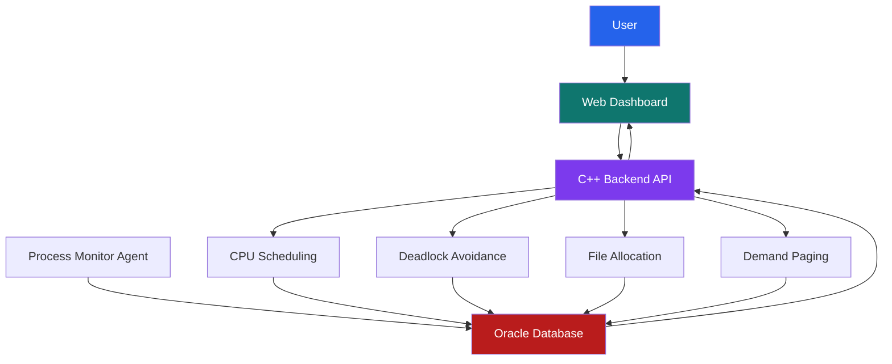

# ⚙️ Kernel Query Execution & Paging System

  

  <strong>A unified simulation environment for Operating System algorithms and database-driven execution.</strong>

  
  
  
  
  

  <a href="#-overview">Overview</a> •
  <a href="#-modules">Modules</a> •
  <a href="#-architecture">Architecture</a> •
  <a href="#-api-reference">API</a> •
  <a href="#-setup">Setup</a>

---

## 🖥️ Project at a Glance

| Component | Implementation |
|---|---|
| Core Engine | C++17 |
| Database | Oracle Database Free |
| Database Connectivity | Oracle OCCI |
| Backend | C++ REST API |
| Frontend | HTML, CSS, JavaScript |
| Deployment | Docker |
| Memory Algorithms | FIFO, LRU, Optimal |
| Scheduling | FCFS, Round Robin |

  <i>Simulate. Analyze. Persist. Understand.</i>

---

## ✨ Overview

Kernel Query Execution & Paging System integrates fundamental Operating System algorithms with relational database management through a unified web dashboard.

The platform allows users to execute algorithms, visualize intermediate states, compare execution results, and persist simulation records in Oracle Database.

  
  
  
  
  
  

## 🏗️ System Architecture

## 🧠 Algorithm Explorer

<strong>⚡ CPU Scheduling</strong>

- First Come First Serve (FCFS)
- Round Robin (RR)
- Execution order and scheduling metrics

<strong>🔒 Deadlock Avoidance</strong>

- Banker's Algorithm
- Allocation, Maximum and Need matrices
- Safe-state detection
- Safe sequence generation

<strong>📁 Contiguous File Allocation</strong>

- Consecutive disk block allocation
- File storage representation
- Allocation visualization

<strong>🧮 Demand Paging</strong>

- FIFO Page Replacement
- LRU Page Replacement
- Optimal Page Replacement
- Page hits and page faults
- Frame-by-frame execution visualization
- Algorithm comparison and Oracle persistence

<strong>📊 Process Monitoring</strong>

- Process identification
- CPU utilization
- Memory utilization
- Periodic resource measurements

| Algorithm | Page Hits | Page Faults | Fault Ratio |
|---|---:|---:|---:|
| FIFO | 3 | 10 | 76.92% |
| LRU | 4 | 9 | 69.23% |
| Optimal | 6 | 7 | 53.85% |
## 📈 Repository Insights

  

  
  
  

